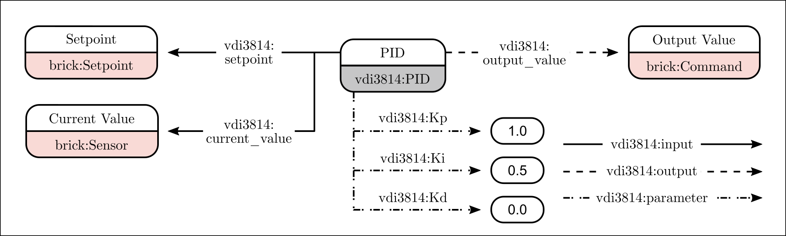

# VDI 3814 Ontology Snippets for Building Automation Functions

This repository provides a compact RDF/OWL profile and SHACL validation setup to model functions defined in the VDI 3814 “Gebäudeautomation (GA)” universe. PID is only an example; the same pattern applies to any GA function (e.g., switching, sequencing, frost protection, demand control).

### Core concept
- We model a generic vdi3814:Function as the central abstraction for GA functions. Concrete functions (like vdi3814:PID, vdi3814:Sequence, vdi3814:Limiter) are subclasses of vdi3814:Function via rdfs:subClassOf. This inheritance means all concrete functions automatically fulfill the general expectations placed on vdi3814:Function.
- Inputs and outputs are expressed through high-level properties vdi3814:Input and vdi3814:Output. Specializations such as vdi3814:setpoint or vdi3814:current_value are subproperties of vdi3814:Input. Similarly, specialized outputs are subproperties of vdi3814:Output. Tunable values are attached via vdi3814:Parameter, with concrete parameters (e.g., vdi3814:kp, vdi3814:deadband) modeled as subproperties of vdi3814:Parameter.
- With RDFS inference, constraints and semantics declared for the generic properties/classes propagate to their specializations and subclasses. That lets you define rules once and reuse them across many concrete function types.

### Validation with SHACL
1) Any subject that uses vdi3814:Input, vdi3814:Output, or vdi3814:Parameter is an instance of vdi3814:Function (ClassConstraintComponent).
2) Input/Output objects are Brick points (brick:Point), enabling alignment with Brick.
3) Parameter objects are literals (nodeKind sh:Literal).

### Illustration
The diagram shows one concrete function instance (a PID) wired with inputs, an output value, and parameters—merely as an example of the general Function pattern.

Notes
You can add new function types by declaring a subclass of vdi3814:Function and introducing specialized subproperties of vdi3814:Input/Output/Parameter as needed. The SHACL rules will apply automatically.
